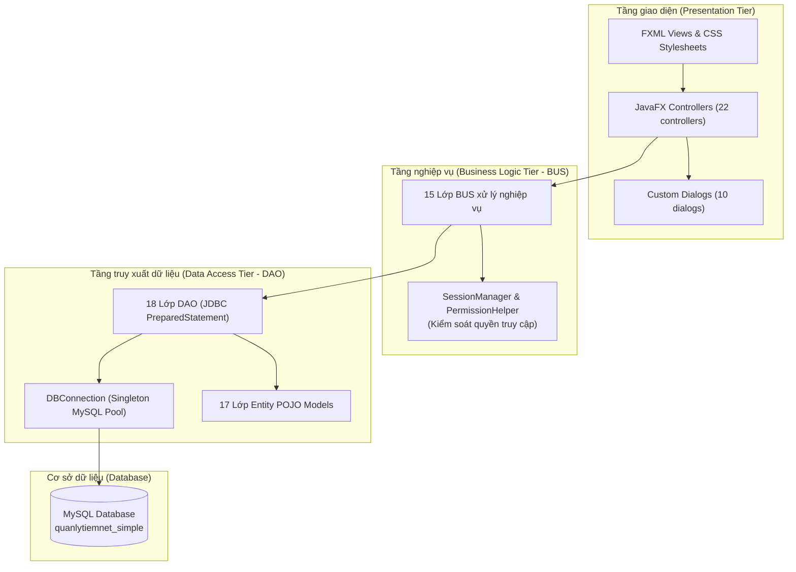
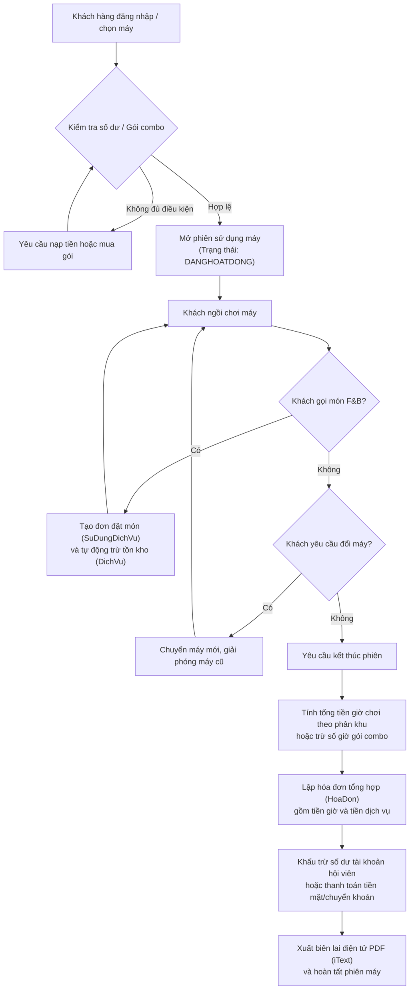
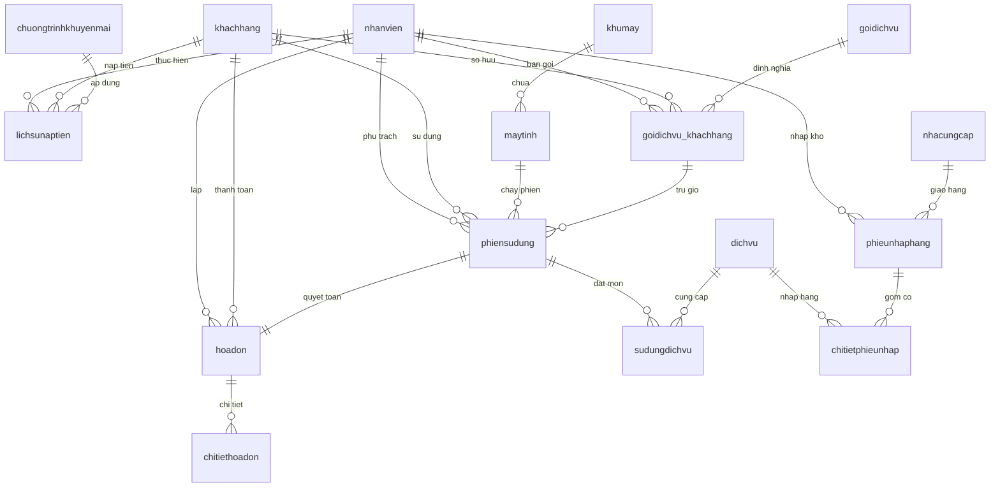

<div align="center">
  <h1>📊 Hệ Thống Quản Lý Quán Net</h1>
  <p><i>Hệ thống quản lý phòng máy Internet và dịch vụ đi kèm dành cho người quản trị, nhân viên thu ngân và khách hàng.</i></p>

  <p>
    <a href="https://img.shields.io/badge/M%C3%B4n_h%E1%BB%8Dc-ISAD-blue"></a>
    <a href="https://img.shields.io/badge/H%E1%BB%8Dc_k%E1%BB%B3-HK1_2026--2027-orange"></a>
    <a href="https://img.shields.io/badge/Java-21-ED8B00?logo=openjdk&logoColor=white"></a>
    <a href="https://img.shields.io/badge/JavaFX-21-0078D7?logo=java&logoColor=white"></a>
    <a href="https://img.shields.io/badge/MySQL-8.0%20%7C%209.x-4479A1?logo=mysql&logoColor=white"></a>
    <a href="https://img.shields.io/badge/draw.io-F08705?logo=diagramsdotnet&logoColor=white"></a>
    <a href="https://img.shields.io/badge/Maven-3.x-C71A36?logo=apache-maven&logoColor=white"></a>
  </p>

  <p>
    <a href="#gioi-thieu">Giới thiệu</a> •
    <a href="#pham-vi-nghiep-vu">Nghiệp vụ</a> •
    <a href="#phan-tich-he-thong">Phân tích</a> •
    <a href="#thiet-ke-du-lieu">Thiết kế</a> •
    <a href="#cau-truc-thu-muc">Cấu trúc</a> •
    <a href="#thanh-vien-nhom">Nhóm</a>
  </p>
</div>

---

<a id="thong-tin-do-an"></a>
## 📋 Thông tin đồ án

| Mục | Nội dung |
|---|---|
| Trường | Trường Đại học Sài Gòn (SGU) |
| Môn học | Phân tích thiết kế hệ thống thông tin (Information Systems Analysis and Design - ISAD) |
| Học kỳ | HK1, năm học 2026-2027 |
| Giảng viên | ThS. Phan Nguyệt Minh |
| Nhóm | Nhóm 49:<br>1. Phạm Duy Đăng (NT) - MSSV: 3124410068<br>2. Nguyễn Phúc Thắng - MSSV: 3124410331<br>3. Nguyễn Vương Hoàng Tịnh - MSSV: 3124560091<br>4. Nguyễn Thành Long - MSSV: 3124410195<br>5. Nguyễn Phú Tài - MSSV: 3121410435<br>6. Châu Chí Hải - MSSV: 3124410076 |

<a id="gioi-thieu"></a>
## 🎯 Giới thiệu

Quán net thường gặp nhiều khó khăn trong việc theo dõi tập trung trạng thái các máy trạm, kiểm soát thời gian sử dụng và quản lý doanh thu dịch vụ phát sinh trong phòng máy. Mục tiêu của đồ án là xây dựng hệ thống phần mềm hỗ trợ tự động hóa việc tính cước giờ chơi theo thời gian thực (real-time), quản lý gọi món đồ ăn thức uống, bán gói combo giờ chơi và nạp tiền tài khoản hội viên. Phạm vi hệ thống là ứng dụng máy tính bàn (desktop application) phục vụ công tác vận hành nội bộ của người quản lý, thao tác nghiệp vụ của nhân viên thu ngân và chức năng tự phục vụ của khách hàng tại máy trạm.

<a id="pham-vi-nghiep-vu"></a>
## 🧩 Phạm vi nghiệp vụ

### Nghiệp vụ dùng chung (Quản lý và Thu ngân)

| Chức năng | Mô tả ngắn |
|---|---|
| Sơ đồ máy | Theo dõi trực quan trạng thái hoạt động (sẵn sàng, đang sử dụng, bảo trì, hỏng) của từng máy tính theo phân khu. |
| Quản lý phiên sử dụng | Mở phiên máy cho khách hàng, hỗ trợ chuyển đổi máy đang ngồi và kết thúc phiên chơi. |
| Quản lý máy tính | Quản lý danh sách máy trạm, cấu hình phần cứng và theo dõi tình trạng thiết bị. |
| Quản lý khu máy | Phân chia các khu vực phòng máy và thiết lập đơn giá cước cơ sở theo từng giờ. |
| Quản lý dịch vụ F&B | Quản lý danh mục đồ ăn, nước uống và tự động khấu trừ số lượng tồn kho khi phục vụ khách. |
| Quản lý gói cước combo | Bán các gói giờ chơi trả trước (combo sáng, combo đêm, gói ngày, gói tuần, gói tháng) cho khách hàng. |
| Nạp tiền tài khoản | Nạp tiền vào tài khoản hội viên và tự động ghi nhận khuyến mãi theo tỷ lệ quy định. |
| Lập hóa đơn và xuất PDF | Quyết toán chi phí giờ chơi cùng dịch vụ trong phiên và xuất biên lai thanh toán ra tệp PDF (Portable Document Format - định dạng tài liệu di động). |
| Quản lý khách hàng | Quản lý hồ sơ hội viên, cập nhật thông tin liên hệ và số dư tài khoản khả dụng. |

### Nghiệp vụ chỉ dành cho Quản lý

| Chức năng | Mô tả ngắn |
|---|---|
| Quản trị nhân viên | Quản lý danh sách nhân sự, phân quyền vai trò (quản lý, thu ngân, nhân viên) và khóa tài khoản khi nghỉ việc. |
| Thống kê doanh thu | Xem báo cáo tài chính tổng hợp theo ngày, theo tháng và xuất dữ liệu sang tệp bảng tính Excel. |
| Quản lý nhập hàng | Quản lý danh bạ nhà cung cấp, lập phiếu nhập kho hàng hóa và cập nhật giá vốn. |
| Quản lý chương trình khuyến mãi | Thiết lập các chính sách chiết khấu nạp tiền theo phần trăm hoặc tặng thêm giờ chơi. |

### Chức năng dành cho Khách hàng

| Chức năng | Mô tả ngắn |
|---|---|
| Tra cứu tài khoản | Xem thông tin cá nhân, số dư tài khoản hiện có và trạng thái tài khoản hội viên. |
| Lịch sử phiên sử dụng | Tra cứu danh sách các phiên máy đã chơi, thời gian bắt đầu, kết thúc và cước phí tương ứng. |
| Quản lý gói cước sở hữu | Theo dõi số giờ còn lại và ngày hết hạn của các gói combo đã mua. |
| Tự đặt dịch vụ tại máy | Gọi đồ ăn, thức uống trực tiếp từ máy trạm đang ngồi để nhân viên tiếp nhận và phục vụ. |

<a id="phan-tich-he-thong"></a>
## 🔍 Phân tích hệ thống

### Kiến trúc phân tầng hệ thống (3-Tier Architecture)

Sơ đồ thể hiện cấu trúc 3 tầng (3-Tier Architecture) phân tách giữa tầng hiển thị giao diện, tầng xử lý quy tắc nghiệp vụ và tầng truy xuất dữ liệu:



Dữ liệu từ màn hình giao diện FXML được các bộ điều khiển tiếp nhận và chuyển đến tầng BUS để kiểm tra tính hợp lệ nghiệp vụ trước khi tầng DAO thực thi các câu lệnh truy vấn xuống cơ sở dữ liệu MySQL.

> [!NOTE]
> Sơ đồ kiến trúc phân lớp được dựng lại từ cấu trúc mã nguồn thực tế trong thư mục `src/main/java/` để minh họa luồng xử lý của hệ thống.

### Vòng đời phiên sử dụng và luồng thanh toán

Sơ đồ mô tả quy trình từ lúc khách hàng bắt đầu ngồi máy, gọi món dịch vụ trong phiên cho đến khi tính cước và lập biên lai thanh toán:



Quy trình đảm bảo tính cước phí chính xác theo từng block thời gian, kết hợp quản lý việc trừ dần số lượng tồn kho dịch vụ ngay khi có yêu cầu gọi món từ khách hàng.

> [!NOTE]
> Sơ đồ luồng nghiệp vụ phiên sử dụng được dựng lại từ logic xử lý thực tế trong các lớp `PhienSuDungBUS`, `HoaDonBUS` và `SuDungDichVuBUS`.

<a id="thiet-ke-du-lieu"></a>
## 🗄️ Thiết kế dữ liệu

Cơ sở dữ liệu của hệ thống mang tên `quanlytiemnet_simple`, được thiết kế trên hệ quản trị cơ sở dữ liệu MySQL với 16 bảng dữ liệu chuẩn hóa nhằm đảm bảo tính toàn vẹn quan hệ.

### Sơ đồ quan hệ thực thể (ERD - Entity Relationship Diagram)



### Danh mục các bảng dữ liệu

| Bảng | Mục đích | Khóa chính |
|---|---|---|
| `nhanvien` | Lưu trữ thông tin nhân viên và tài khoản đăng nhập theo chức vụ (quản lý, thu ngân, nhân viên). | `MaNV` |
| `khachhang` | Quản lý thông tin hội viên, số điện thoại, mật khẩu và số dư tài khoản khả dụng. | `MaKH` |
| `khumay` | Danh mục các phân khu phòng máy (khu thường, VIP, thi đấu, couple, hút thuốc) kèm giá cước cơ sở. | `MaKhu` |
| `maytinh` | Danh sách các máy trạm, cấu hình phần cứng, đơn giá thuê mỗi giờ và trạng thái hoạt động. | `MaMay` |
| `phiensudung` | Ghi nhận chi tiết từng phiên ngồi máy của khách (giờ bắt đầu, giờ kết thúc, tổng tiền giờ). | `MaPhien` |
| `dichvu` | Danh mục các món đồ ăn, thức uống, thẻ game kèm đơn vị tính, đơn giá bán và số lượng tồn kho. | `MaDV` |
| `sudungdichvu` | Danh sách các món dịch vụ khách hàng gọi trong suốt phiên sử dụng máy. | `MaSDDV` |
| `goidichvu` | Bảng định mức các gói cước combo giờ chơi trả trước (combo sáng, combo đêm, gói ngày, gói tuần, gói tháng). | `MaGoi` |
| `goidichvu_khachhang` | Ghi nhận các gói combo khách hàng đã mua, số giờ còn lại và thời hạn sử dụng. | `MaGoiKH` |
| `hoadon` | Bảng hóa đơn tổng kết chi phí giờ chơi và chi phí dịch vụ khi hoàn tất phiên máy. | `MaHD` |
| `chitiethoadon` | Chi tiết các khoản mục thanh toán trong hóa đơn (phân loại giờ chơi hoặc dịch vụ). | `MaCTHD` |
| `chuongtrinhkhuyenmai` | Quản lý các chương trình khuyến mãi nạp tiền (chiết khấu phần trăm, tặng tiền hoặc tặng giờ). | `MaCTKM` |
| `lichsunaptien` | Nhật ký giao dịch nạp tiền vào tài khoản hội viên kèm thông tin khuyến mãi được hưởng. | `MaLS` |
| `nhacungcap` | Danh bạ các đối tác cung cấp nguyên vật liệu, nước ngọt và thực phẩm cho tiệm net. | `MaNCC` |
| `phieunhaphang` | Hóa đơn nhập hàng hóa từ nhà cung cấp vào kho của tiệm net. | `MaPhieuNhap` |
| `chitietphieunhap` | Chi tiết số lượng và giá nhập của từng mặt hàng dịch vụ trong mỗi phiếu nhập kho. | `MaCTPN` |

<a id="cong-cu-su-dung"></a>
## 🛠️ Công cụ sử dụng

| Thành phần | Công nghệ | Vai trò |
|---|---|---|
| Ngôn ngữ lập trình | Java 21 | Xây dựng mã nguồn phía máy khách và xử lý logic ứng dụng. |
| Giao diện người dùng | JavaFX 21 (Controls, FXML, Graphics, Base) | Thiết kế và hiển thị giao diện đồ họa người dùng. |
| Thư viện biểu tượng | Ikonli Material Design 2 (12.3.1) | Cung cấp hệ thống phông biểu tượng giao diện. |
| Hệ quản trị cơ sở dữ liệu | MySQL 8.0 / 9.x | Lưu trữ và quản lý cơ sở dữ liệu quan hệ của hệ thống. |
| Trình điều khiển kết nối | MySQL Connector/J (8.3.0) | Cung cấp giao thức kết nối JDBC giữa ứng dụng Java và MySQL. |
| Xuất tệp PDF | iText PDF (5.5.13.3) | Khởi tạo và kết xuất tệp biên lai hóa đơn thanh toán. |
| Xuất tệp Excel | Apache POI & POI-OOXML (5.5.1) | Kết xuất dữ liệu báo cáo thống kê doanh thu sang định dạng .xlsx. |
| Công cụ quản lý dự án | Apache Maven (3.x) | Quản lý vòng đời dự án, gói thư viện phụ thuộc và tiến trình biên dịch. |
| Phân tích thiết kế | draw.io | Xây dựng các mô hình nghiệp vụ (BFD, DFD, ERD). |
| Quản lý phiên bản | Git & GitHub | Quản lý mã nguồn phân tán và cộng tác nhóm. |

<a id="cau-truc-thu-muc"></a>
## 📁 Cấu trúc thư mục

```
quan-ly-tiem-net-pttkhtt/
├── database/              # Chứa kịch bản SQL khởi tạo cơ sở dữ liệu và nạp dữ liệu mẫu ban đầu
├── docs/                  # Tài liệu báo cáo phân tích thiết kế hệ thống thông tin (.docx)
├── src/                   # Thư mục mã nguồn chính và tài nguyên giao diện của ứng dụng
│   ├── main/java/         # Mã nguồn Java (entity, dao, bus, gui, utils, test)
│   └── main/resources/    # Tài nguyên giao diện FXML, CSS và phông chữ biểu tượng
├── pom.xml                # Tệp cấu hình thư viện phụ thuộc và plugin đóng gói của Maven
├── README.md              # Tài liệu giới thiệu và đặc tả hệ thống
├── README.old.md          # Bản lưu trữ tài liệu README phiên bản trước
└── LICENSE                # Tệp điều khoản giấy phép mã nguồn mở theo chuẩn MIT
```

<a id="cai-dat-va-chay"></a>
## 🚀 Cài đặt và chạy

> [!NOTE]
> Hệ thống yêu cầu cài đặt sẵn Java Development Kit (JDK) phiên bản 21 trở lên và máy chủ MySQL đang ở trạng thái hoạt động trước khi khởi chạy ứng dụng.

1. Sao chép kho lưu trữ mã nguồn về máy tính cá nhân:
```bash
git clone https://github.com/duyddawngnef/quan-ly-tiem-net-pttkhtt.git
```
- `git clone`: Lệnh sao chép toàn bộ cây thư mục và lịch sử cam kết từ kho lưu trữ từ xa về máy cục bộ.
- `https://github.com/duyddawngnef/quan-ly-tiem-net-pttkhtt.git`: Địa chỉ mạng của kho lưu trữ dự án trên GitHub.

2. Di chuyển vào thư mục gốc của dự án:
```bash
cd quan-ly-tiem-net-pttkhtt
```
- `cd`: Lệnh điều hướng dòng lệnh vào thư mục được chỉ định.
- `quan-ly-tiem-net-pttkhtt`: Tên thư mục gốc của dự án vừa được tạo sau khi sao chép.

3. Khởi tạo cơ sở dữ liệu trên máy chủ MySQL:
> [!WARNING]
> Kịch bản SQL sẽ tạo mới cơ sở dữ liệu `quanlytiemnet_simple`. Nếu trên máy chủ MySQL của bạn đã tồn tại cơ sở dữ liệu cùng tên, dữ liệu cũ có thể bị ghi đè. Cần kiểm tra kỹ trước khi chạy lệnh.

```bash
mysql -u root -p < database/quanlytiemnet.sql
```
- `mysql`: Trình thực thi dòng lệnh của hệ quản trị cơ sở dữ liệu MySQL.
- `-u root`: Tùy chọn chỉ định tài khoản quản trị viên MySQL (root).
- `-p`: Tùy chọn yêu cầu nhập mật khẩu bảo vệ tương ứng với tài khoản.
- `< database/quanlytiemnet.sql`: Ký hiệu chuyển hướng tệp kịch bản SQL có sẵn làm dữ liệu đầu vào.

4. Cấu hình thông tin kết nối cơ sở dữ liệu:
> [!NOTE]
> Tệp `src/main/resources/config.properties` hiện đang là tệp rỗng (0 byte). Thông số kết nối MySQL được đọc trực tiếp từ lớp `src/main/java/dao/DBConnection.java`.

Mở tệp `src/main/java/dao/DBConnection.java` bằng trình soạn thảo mã nguồn và điều chỉnh các hằng số sau cho phù hợp với tài khoản máy chủ MySQL của bạn:
- `HOST`: Địa chỉ IP của máy chủ MySQL (mặc định: `127.0.0.1`).
- `PORT`: Cổng dịch vụ MySQL (mặc định: `3306`).
- `USER`: Tên tài khoản MySQL (mặc định: `root`).
- `PASS`: Mật khẩu của tài khoản MySQL.

5. Biên dịch mã nguồn dự án:
```bash
mvn clean compile
```
- `mvn`: Lệnh gọi công cụ xây dựng dự án Apache Maven.
- `clean`: Xóa toàn bộ thư mục `target/` chứa các tệp nhị phân đã biên dịch từ lần chạy trước.
- `compile`: Biên dịch toàn bộ các tệp mã nguồn Java nằm trong `src/main/java/`.

6. Khởi chạy ứng dụng:
```bash
mvn javafx:run
```
- `mvn`: Lệnh gọi công cụ Apache Maven.
- `javafx:run`: Mục tiêu của plugin `javafx-maven-plugin` để tải các thư viện JavaFX và khởi động ứng dụng từ lớp `Main`.

7. Mở và xem tài liệu báo cáo phân tích thiết kế hệ thống:
Mở tệp `docs/BaoCao_QuanLyQuanNet_PTTKHTT.docx` bằng Microsoft Word, Google Docs hoặc LibreOffice Writer để xem chi tiết toàn văn khảo sát, bảng hỏi và các mô hình phân tích thiết kế hệ thống.

<a id="thanh-vien-nhom"></a>
## 👥 Thành viên nhóm

| STT | Họ tên | GitHub | Vai trò |
|:---:|---|---|---|
| 1 | Phạm Duy Đăng (MSSV: 3124410068) | [@duyddawngnef](https://github.com/duyddawngnef) | Trưởng nhóm (NT) - Phụ trách module Đăng nhập, Quản lý nhân viên và kiến trúc nền tảng |
| 2 | Nguyễn Phúc Thắng (MSSV: 3124410331) | [@Thangphuc1](https://github.com/Thangphuc1) | Thành viên - Phụ trách module Quản lý khu máy và danh mục máy tính |
| 3 | Nguyễn Vương Hoàng Tịnh (MSSV: 3124560091) | [@ALEXDASID](https://github.com/ALEXDASID) | Thành viên - Phụ trách module Nạp tiền tài khoản, Hóa đơn (PDF) và Khuyến mãi |
| 4 | Nguyễn Thành Long (MSSV: 3124410195) | [@Longcodepro](https://github.com/Longcodepro) | Thành viên - Phụ trách module Quản lý dịch vụ F&B và Gói cước combo |
| 5 | Nguyễn Phú Tài (MSSV: 3121410435) | [@NgPhuTai](https://github.com/NgPhuTai) | Thành viên - Phụ trách module Quản lý nhập hàng, Nhà cung cấp và Thống kê (Excel) |
| 6 | Châu Chí Hải (MSSV: 3124410076) | [@chihai9-dev](https://github.com/chihai9-dev) | Thành viên - Phụ trách module Sơ đồ máy, Quản lý phiên sử dụng và tính cước |

<a id="tai-lieu-lien-quan"></a>
## 📄 Tài liệu liên quan

- Báo cáo phân tích thiết kế hệ thống thông tin: `docs/BaoCao_QuanLyQuanNet_PTTKHTT.docx`
- Kịch bản thiết kế cơ sở dữ liệu quan hệ: `database/quanlytiemnet.sql`
- Giấy phép phân phối mã nguồn mở: `LICENSE`
